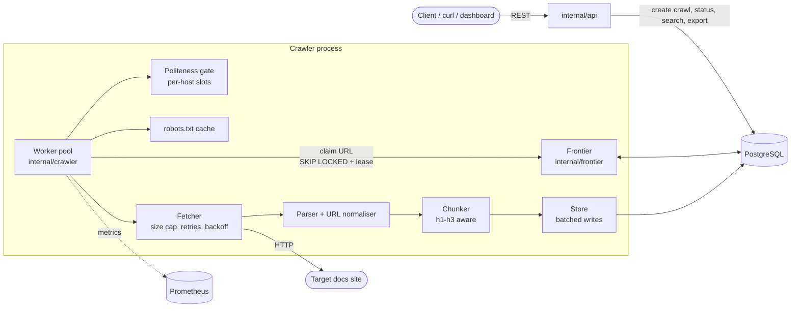

# docs-rag-ingest (CrawlerX)

A resumable, polite web crawler in Go that turns documentation sites into clean, heading-aware text chunks ready for embedding in a RAG (retrieval-augmented generation) pipeline.


> **Only crawl your own site, or sites that allow it.** The API has no authentication and `POST /crawls` makes the server fetch URLs: keep it on a private network.

## The problem

Feeding a RAG system from a docs site is harder than "fetch pages, split text":

- **Crawlers die.** A long crawl that crashes at page 8,000 shouldn't start over or re-fetch what it already has.
- **Being rude gets you banned.** You need `robots.txt`, per-host rate limits, `Retry-After`, and backoff.
- **Raw HTML is noisy.** Nav bars, footers, and sidebars pollute embeddings and retrieval.
- **Fixed-size splits lose context.** A chunk should know which page and heading it came from.
- **Re-crawls are wasteful.** Unchanged pages shouldn't be re-chunked or re-embedded.

CrawlerX solves these with a durable, Postgres-backed frontier, in-process politeness, main-content extraction, and a chunk export endpoint that outputs one JSON chunk per line.

## Features

- **Crash-safe and resumable**: work lives in Postgres. `kill -9` it, restart without `-seed`, and it finishes what's pending without re-crawling completed pages.
- **Polite by default**: RFC 9309 `robots.txt` (Allow/Disallow, wildcards, Crawl-delay), one request slot per host per delay, `Retry-After`, full-jitter backoff, honest User-Agent.
- **RAG-ready export**: main-content extraction, heading-aware chunks (max 1500 chars), stable content hashes.
- **Scoped crawling**: depth limit (shallowest-first, so "N hops" means N hops) and `path_prefixes` to stay inside `/docs/`.
- **Incremental**: unchanged pages keep their chunks; ETag / Last-Modified are stored.
- **Full-text search** over crawled pages (`tsvector` + GIN) and a small built-in dashboard.
- **Observable**: Prometheus metrics at `/metrics`, health check at `/healthz`.

## Architecture



**Crawl loop**, per worker:

1. **Claim** the shallowest pending URL from Postgres with `FOR UPDATE SKIP LOCKED` and a lease. If the process dies, the lease expires and the URL is re-claimed.
2. **Politeness check**: if the host's slot isn't free, the URL is rescheduled (not slept on), so workers never block each other.
3. **robots.txt check**, then **fetch** (2 MiB cap, HTML only, redirects are queued like any other link).
4. **Parse** once: title, main content, links, `<base href>`, meta robots. Links are canonicalised and enqueued; the visited set is the same table as the queue.
5. **Chunk** the main content at h1-h3 and **store** pages and chunks in batches.

| Package | Responsibility |
|---|---|
| `internal/frontier` | Queue + visited set in one table; leases; crash recovery; depth and path scoping |
| `internal/politeness` | In-process per-host rate gate |
| `internal/robots` | RFC 9309 parsing via `temoto/robotstxt`; 4xx = allow, 5xx = disallow; in-memory cache |
| `internal/fetch` | HTTP client: size cap, content-type filter, `Retry-After`, jittered backoff |
| `internal/parse`, `internal/urlnorm` | Single-pass HTML parse; URL canonicalisation (fuzz-tested) |
| `internal/chunk` | Heading-aware splitting into chunks of at most 1500 characters |
| `internal/store` | Batched page/chunk writes, content hashing, full-text index |
| `internal/api` | REST API and embedded dashboard |
| `internal/metrics` | Prometheus collectors |
| `internal/db` | Connection and embedded SQL migrations |
| `internal/fakesite`, `cmd/fakesite` | Synthetic docs site for tests and benchmarks |

## Tech stack

| Area | Choice |
|---|---|
| Language | Go 1.26 (standard library `net/http` mux, `embed`) |
| Database / queue | PostgreSQL via `pgx/v5` (leases with `SKIP LOCKED`, `tsvector` + GIN search) |
| robots.txt | `temoto/robotstxt` |
| Metrics | Prometheus `client_golang` |
| Packaging | Docker, Docker Compose |
| Deploy | Render Blueprint (`render.yaml`) |
| Testing | `go test` with `-race`, fuzz tests, end-to-end `kill -9` / SIGTERM tests |

## Quick start

With Docker:

```sh
make up                                   # postgres, fakesite, crawler
curl -XPOST localhost:8080/crawls -d '{"seed":"http://fakesite:9000/","max_depth":6}'
curl localhost:8080/crawls/1              # counts by status, "done": true when finished
curl 'localhost:8080/search?q=nebula'
open http://localhost:8080                # dashboard
curl localhost:8080/metrics
```

Without Docker (bring your own Postgres):

```sh
export DATABASE_URL=postgres://...
go run ./cmd/fakesite -pages 500 &
go run ./cmd/crawlerx -seed http://127.0.0.1:9000/ -max-depth 6 -exit-when-done
```

To **resume** after a crash, restart `crawlerx` *without* `-seed`; it works whatever is pending. (`-seed` starts a new crawl.)

Configuration is flags with environment-variable fallbacks: see `go run ./cmd/crawlerx -h`.

## Docs-to-RAG export

Crawl a docs site, then pull chunks:

```sh
curl -XPOST localhost:8080/crawls \
  -d '{"seed":"https://docs.example.com/docs/","max_depth":5,"path_prefixes":["/docs/"]}'
curl localhost:8080/crawls/1/export > chunks.jsonl   # one JSON chunk per line
```

Each line:

```json
{"id": 42, "url": "https://docs.example.com/docs/setup", "title": "Setup", "heading": "Install", "text": "...", "content_hash": "..."}
```

Text comes from `<main>` (else `<article>`, else `<body>`), without nav/header/footer/aside/forms, split at h1-h3 into chunks of at most 1500 characters. Re-crawling an unchanged page keeps its chunks. `path_prefixes` is also available as `-path-prefixes` / `PATH_PREFIXES` for the `-seed` crawl.

## API

| Method | Path | Purpose |
|---|---|---|
| `POST` | `/crawls` | Start a crawl (`seed`, `max_depth`, `path_prefixes`) |
| `GET` | `/crawls` | List crawls |
| `GET` | `/crawls/{id}` | Counts by status; `done: true` when finished |
| `GET` | `/crawls/{id}/depths` | Pages per depth |
| `GET` | `/crawls/{id}/export` | JSONL chunks for embedding |
| `GET` | `/search?q=` | Full-text search over crawled pages |
| `GET` | `/healthz` | Health check |
| `GET` | `/metrics` | Prometheus metrics |

## Testing

```sh
go test -short ./...    # no services needed
make test               # all tests with -race; needs TEST_DATABASE_URL
make bench              # throughput benchmark
```

Includes a deadlock regression test and end-to-end tests that `kill -9` and SIGTERM the crawler mid-run and verify it resumes correctly. Benchmark results and caveats: [docs/BENCHMARK.md](docs/BENCHMARK.md). Design notes: [docs/CONCEPTS.md](docs/CONCEPTS.md).

## Deploy

`render.yaml` is a Render Blueprint: one Docker web service plus a Render Postgres. The API has no authentication, so put it behind a private network or auth proxy before exposing it publicly.

## Limitations

- Single process: politeness is enforced in memory, so run one crawler per Postgres.
- Static HTML only; no JavaScript rendering.
- No built-in authentication on the API.
