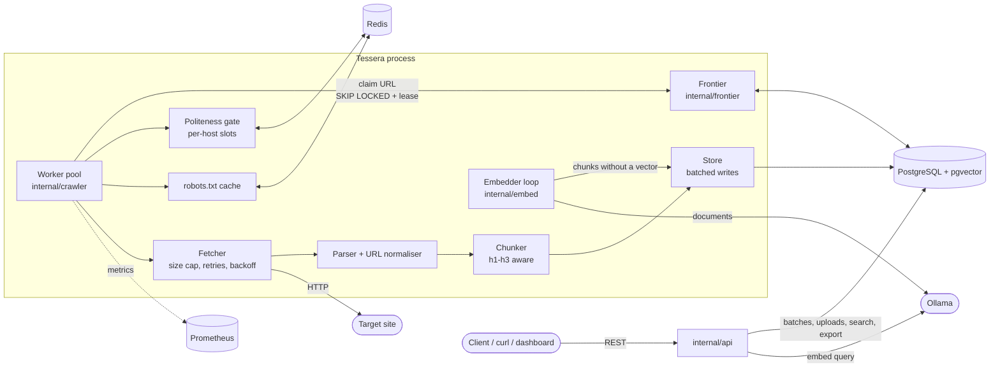

# Tessera

**Feed it documents, search them by meaning.**

Give Tessera page URLs and uploaded PDF, Markdown, HTML or text files. It cuts them into small heading-aware passages, embeds each passage locally with [Ollama](https://ollama.com), stores the vectors in Postgres with [pgvector](https://github.com/pgvector/pgvector), and lets you ask questions in your own words. Under the hood it is a resumable, polite web crawler in Go: work lives in Postgres (a lease-based queue using `FOR UPDATE SKIP LOCKED`), per-host politeness is shared through Redis, and any number of processes can crawl together. Kill one with `kill -9` and the rest (or a restart) finish its work without re-crawling pages that were already done.


*Why "Tessera"?* A tessera is one small tile of a mosaic. Each passage is a tile; search finds the tiles that fit your question. (Formerly CrawlerX, repo `docs-rag-ingest`: see [Upgrading from CrawlerX](#upgrading-from-crawlerx).)

> **Only crawl your own site, or sites that allow it.** The API has no authentication and `POST /crawls` and `POST /batches` make the server fetch URLs. Keep it on a private network.

## The problem

Feeding a RAG system from documents is harder than "fetch pages, split text":

- **Crawlers die.** A long crawl that crashes at page 8,000 shouldn't start over or re-fetch what it already has.
- **Being rude gets you banned.** You need `robots.txt`, per-host rate limits, `Retry-After`, and backoff.
- **Raw HTML is noisy.** Nav bars, footers, and sidebars pollute embeddings and retrieval.
- **Fixed-size splits lose context.** A chunk should know which page and heading it came from.
- **Re-crawls are wasteful.** Unchanged pages shouldn't be re-chunked or re-embedded.
- **Not everything is a web page.** Handbooks live in PDFs and Markdown files, and they belong in the same search.

## Features

- **Crash-safe and resumable**: work lives in Postgres. `kill -9` it, restart without `-seed`, and it finishes what's pending without re-crawling completed pages.
- **Polite by default**: RFC 9309 `robots.txt` (Allow/Disallow, wildcards, Crawl-delay), one request slot per host per delay shared across processes, `Retry-After`, full-jitter backoff, honest User-Agent.
- **Batches of documents**: page URLs and uploaded PDF, Markdown, HTML or text files, searched together or one by one.
- **Semantic search**: passages embedded in the background with `nomic-embed-text`, searched with pgvector. Crawling never waits on embedding.
- **RAG-ready export**: main-content extraction, heading-aware chunks (max 1500 chars), stable content hashes, JSONL export.
- **Scoped crawling**: depth limit (shallowest-first, so "N hops" means N hops), `path_prefixes` to stay inside `/docs/`, and an allowed-host list.
- **Incremental**: unchanged pages and files keep their chunks and vectors; ETag / Last-Modified are stored.
- **Keyword search** over crawled pages (`tsvector` + GIN) and a small built-in dashboard.
- **Observable**: Prometheus metrics at `/metrics`, health check at `/healthz`.

## Architecture



**Crawl loop**, per worker:

1. **Claim** the shallowest pending URL from Postgres with `FOR UPDATE SKIP LOCKED` and a lease. If the process dies, the lease expires and the URL is re-claimed.
2. **Politeness check**: if the host's slot isn't free, the URL is rescheduled (not slept on), so workers never block each other.
3. **robots.txt check**, then **fetch** (2 MiB cap, HTML only, redirects are queued like any other link).
4. **Parse** once: title, main content, links, `<base href>`, meta robots. Links are canonicalised and enqueued; the visited set is the same table as the queue.
5. **Chunk** the main content at h1-h3 and **store** pages and chunks in batches. The embedder loop adds vectors later.

## Quick start

```sh
git clone git@github.com:wanderingtilldeath/tessera.git && cd tessera
make up                                   # postgres+pgvector, redis, ollama, fakesite, 2 crawlers (needs Docker)
open http://localhost:8081                # the dashboard
```

The first `make up` downloads the embedding model (about 270 MB, into `./.ollama`). Crawling works while it downloads; passages become searchable as they are embedded. `make down` stops everything and removes the volumes.

In the dashboard:

1. **Add documents**: paste page URLs (one per line), drop or choose files, press **Start**. One line of progress shows what it is doing. *Options* holds the batch name, link depth, path prefixes and allowed hosts (depth 0 ingests exactly the pages you list).
2. **Documents** lists what the batch holds. Tick some to search only those.
3. **Search**: ask in your own words. It searches the ticked documents, else the whole batch.

The page is plain files under `internal/api/static/`, one job each: `index.html` (structure), `style.css` (look), and `js/` modules (`api` is the only one that talks to the server; `add`, `progress`, `library`, `search` and `results` each own one part of the page; `state` and `poller` are shared plumbing). Nothing polls while idle.

## The API

The same flow over HTTP:

```sh
curl -XPOST localhost:8081/batches -d '{"name":"docs","urls":["http://fakesite:9000/p/1"],"max_depth":0}'
curl -XPOST localhost:8081/batches/1/files -F files=@handbook.pdf -F files=@notes.md
curl localhost:8081/batches/1             # progress; "done": true when crawled, read and embedded
curl 'localhost:8081/search/semantic?q=how+many+vacation+days&batch=1'          # omit batch to search everything
curl 'localhost:8081/search/semantic?q=how+many+vacation+days&batch=1&page=2'   # next 10 results
```

| Method | Path | Purpose |
|---|---|---|
| `POST` | `/batches` | Start a batch (`name`, `urls`, `max_depth`, `allowed_hosts`, `path_prefixes`) |
| `GET` | `/batches`, `/batches/{id}` | List batches; progress for one, `done: true` when finished |
| `POST` | `/batches/{id}/files` | Upload PDF, Markdown, HTML or text files |
| `GET` | `/search/semantic?q=` | Search by meaning (`batch`, repeatable `url`, `page`, `limit`) |
| `POST` | `/crawls` | Start a single crawl (`seed`, `max_depth`, `path_prefixes`) |
| `GET` | `/crawls`, `/crawls/{id}` | List crawls; counts by status for one |
| `GET` | `/crawls/{id}/depths` | Pages per depth |
| `GET` | `/crawls/{id}/export` | The crawl's chunks as JSONL (`{id, url, title, heading, text, content_hash}`), if you would rather embed them yourself |
| `GET` | `/search?q=nebula` | Keyword search over page titles and descriptions |
| `GET` | `/healthz`, `/metrics` | Health check, Prometheus metrics |

## Run without Docker

Run Postgres (with pgvector) and Redis yourself:

```sh
export DATABASE_URL=postgres://... REDIS_URL=redis://...
go run ./cmd/fakesite -pages 500 &
go run ./cmd/tessera -seed http://127.0.0.1:9000/ -max-depth 6 -exit-when-done
```

To **resume** after a crash, restart `tessera` *without* `-seed`: it works whatever is pending. (`-seed` starts a new crawl; it also takes `-path-prefixes` / `PATH_PREFIXES`.)

Config is flags with env fallbacks: see `go run ./cmd/tessera -h`.

## How it works

| piece | what it does |
|---|---|
| `internal/frontier` | queue + visited set in one table; claim with `SKIP LOCKED`; expired leases are re-claimed (crash recovery); shallowest-first so the depth limit means "within N hops" |
| `internal/politeness` | Redis Lua gate: one slot per host per delay, shared by all processes; a denied worker reschedules the URL instead of sleeping |
| `internal/robots` | RFC 9309 via `temoto/robotstxt`: Allow/Disallow, wildcards, Crawl-delay; 4xx = allow, 5xx = disallow; cached in Redis |
| `internal/fetch` | size cap (2 MiB), HTML only, honest User-Agent, no inline redirects (a redirect target is queued like any link), `Retry-After`, full-jitter backoff |
| `internal/parse`, `internal/urlnorm` | one parse per page; `<base href>`, meta robots; URL canonicalisation with a fuzz test |
| `internal/chunk` | heading-aware splitting into chunks of at most 1500 characters |
| `internal/store` | batched page writes, `tsvector` + GIN full-text search, ETag/Last-Modified, chunk vectors (pgvector) |
| `internal/batch`, `internal/ingest` | batches of documents; text extraction from PDF, Markdown, HTML and text uploads into the same chunks the crawler produces |
| `internal/embed` | background embedding of chunks through Ollama; crawling never waits on it, and chunks without a vector just stay pending until the model is reachable |
| `internal/api` | REST API and embedded dashboard |
| `internal/metrics`, `internal/db` | Prometheus collectors; connection and embedded SQL migrations |
| `internal/fakesite`, `cmd/fakesite` | synthetic site for tests and benchmarks |

`FEATURES.md` is the living ledger of subsystems, with entry points, data dependencies and trade-offs. Concept notes: [docs/CONCEPTS.md](docs/CONCEPTS.md).

## Tech stack

| Area | Choice |
|---|---|
| Language | Go 1.26 (standard library `net/http` mux, `embed`) |
| Database / queue | PostgreSQL via `pgx/v5` (leases with `SKIP LOCKED`, `tsvector` + GIN search, pgvector HNSW) |
| Shared state | Redis (per-host politeness gate, robots.txt cache) |
| Embeddings | Ollama, `nomic-embed-text` (768 dimensions) |
| robots.txt | `temoto/robotstxt` |
| Metrics | Prometheus `client_golang` |
| Packaging | Docker, Docker Compose |
| Testing | `go test` with `-race`, fuzz tests, end-to-end `kill -9` / SIGTERM tests |

## Semantic search and embeddings

Chunks (heading-aware pieces of at most 1500 characters, taken from `<main>`, else `<article>`, else `<body>`, without nav, header, footer, aside or forms) are embedded with `nomic-embed-text` (768 dimensions) through a local Ollama and stored in Postgres with pgvector. Search embeds your question the same way and returns the closest passages, with their heading and source. Re-crawling or re-uploading an unchanged document keeps its vectors; a changed one is re-embedded.

| setting | meaning |
|---|---|
| `EMBED_URL` / `-embed-url` | Ollama base URL (compose sets `http://ollama:11434`). Empty turns embedding off: chunks are still stored, and `/search/semantic` answers 503. |
| `EMBED_MODEL` / `-embed-model` | model name, default `nomic-embed-text`. It must produce 768-dimension vectors; another size needs a new migration. |

**Postgres must have pgvector.** Migration 00003 runs `CREATE EXTENSION vector`, which needs a role allowed to do that. `make up` uses the `pgvector/pgvector` image. If you bring your own database (including the one behind `TEST_DATABASE_URL`), use a pgvector 0.8+ build.

**Uploads:** PDF, Markdown, HTML or text, up to 25 MB per file, 50 files per request, 200 MB per request. Only the extracted text is stored, not the file. A scanned PDF has no text layer and is reported as unreadable (no OCR). Page URLs must be HTML pages; to ingest a PDF, upload it.

**Results** come in pages: `page` (from 1) and `limit` (page size, default 10, at most 50). The response has `page`, `page_size` and `has_more`. A search returns at most 100 results in total, so `page` past that is a 400. In the dashboard, results show the matched text in a quote block with its source below it: a link for crawled pages, a plain file name for uploads.

Each batch is searched on its own: the same URL may belong to several batches.

## Tests

```sh
go test -short ./...                      # no services needed
make test                                 # all tests, -race, needs TEST_DATABASE_URL and TEST_REDIS_URL (`make up` first)
make bench                                # throughput benchmark
```

The suite includes the original deadlock regression (`internal/crawler/deadlock_test.go`) and end-to-end `kill -9` / SIGTERM / two-process tests (`internal/e2e`). Benchmark results and caveats: [docs/BENCHMARK.md](docs/BENCHMARK.md).

## Limitations

- Static HTML only; no JavaScript rendering.
- No OCR: a scanned PDF with no text layer is reported as unreadable.
- Search is vector-only (no reranking, no keyword blend) and returns at most 100 results.
- No built-in authentication on the API, and no per-client rate limiting.
- No CI workflow; deployments are manual.

## Upgrading from CrawlerX

The project was renamed to Tessera. Things that changed:

- **Metrics**: `crawlerx_*` became `tessera_*`. Update Prometheus dashboards and alerts.
- **Redis keys**: the `crawlerx:` prefix became `tessera:`. Old keys are orphaned and harmless.
- **User-Agent and robots token**: now `Tessera`, so robots.txt rules written for CrawlerX no longer match.
- **Compose database**: user, password and database are now `tessera`. Run `make down` then `make up` to recreate it.
- **Go module and binary**: `github.com/wanderingtilldeath/tessera`, built from `./cmd/tessera`.
